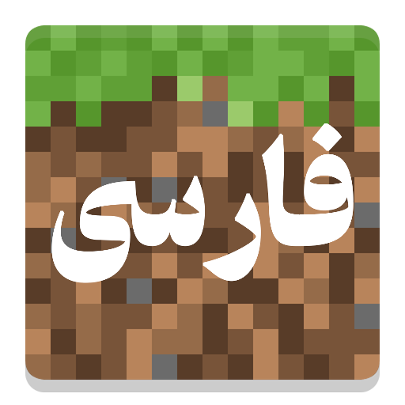

# PersianFont | فونت فارسی ماینکرفت

**Full Persian font & RTL text support for Minecraft 26.2 — Fabric**

---

**[English](#english) · [فارسی](#فارسی)**

---

## English

### Overview

PersianFont is a client-side Fabric mod for Minecraft 26.2 that adds full Persian (Farsi) language rendering support. It includes six carefully selected Persian fonts, a built-in font selection dashboard, proper RTL (right-to-left) text rendering, and correct handling of mixed Persian/English text throughout the game.

### Features

- **6 Built-in Persian Fonts**
  - Sorena — Pixel geometric style
  - Unixel — Pixel, inspired by Naskh script
  - Rooyin — Retro Minecraft-compatible style
  - Vazirmatn — Modern and clean *(by Saber Rastikerdar, SIL OFL)*
  - Sahel — Geometric and modern *(by Saber Rastikerdar, SIL OFL)*
  - Shabnam — Round and cheerful *(by Saber Rastikerdar, SIL OFL)*

- **In-Game Font Dashboard**
  - Open with the `P` key (customizable) or via the Options screen
  - Each font name is previewed in its own typeface
  - Toggle **Bold** and **Italic** styles
  - Four font size options: Small (85%), Normal (100%), Large (115%), X-Large (130%)
  - Custom hotkey binding from within the dashboard

- **Advanced RTL Text Engine**
  - Proper right-to-left rendering in chat, world names, achievements, signs, and all UI
  - Correct mixed Persian/English (BiDi) text — English words inside Persian sentences render in the correct visual order
  - Smooth Persian character reshaping and ligature support
  - Real-time correct display while typing in the chat box

- **Mod Menu Integration**
  - Full configuration screen accessible via Mod Menu

### Requirements

| Dependency | Version |
|---|---|
| Minecraft | 26.2 |
| Fabric Loader | ≥ 0.18.5 |
| Mod Menu | Optional |

### Installation

1. Install [Fabric Loader](https://fabricmc.net/use/) for Minecraft 26.2.
2. Download `PersianFont-1.0.0-mc26.2.jar` from [Modrinth](https://modrinth.com/mod/persianfont) or [CurseForge](https://www.curseforge.com/minecraft/mc-mods/persianfont).
3. Place the file in your Minecraft `mods` folder:
   - Windows: `%appdata%\.minecraft\mods`
4. Launch the game. Press `P` or go to **Options** to open the font dashboard.

### Authors & Credits

- **Creator & Maintainer:** **Awliresa**
- **Code Generation & AI Architecture:** Developed with **Google Gemini**
- **Fonts:** Vazirmatn, Sahel, and Shabnam by [Saber Rastikerdar](https://github.com/rastikerdar) (SIL Open Font License)

---

## فارسی

### معرفی

ماد **PersianFont (فونت فارسی)** یک ماد کلاینت‌ساید برای ماینکرفت 26.2 (Fabric) است که پشتیبانی کامل و اصولی از زبان و قلم‌های فارسی را به بازی اضافه می‌کند. این ماد شامل ۶ قلم زیبای فارسی، داشبورد تنظیمات داخل بازی، راست‌چینی استاندارد متون و رفع کامل به‌هم‌ریختگی جملات ترکیبی فارسی و انگلیسی در تمامی بخش‌های بازی است.

### ویژگی‌ها

- **۶ فونت فارسی آماده و متنوع:**
  - **سورنا:** سبک پیکسلی و هندسی
  - **یونیکسل:** پیکسلی با الهام از خط نسخ
  - **رویین:** رترو و کاملاً هماهنگ با ظاهر ماینکرفت
  - **وزیرمتن:** بسیار روان، تمیز و خوانا *(اثر زنده‌یاد صابر راستی‌کردار، مجوز SIL OFL)*
  - **ساحل:** هندسی، شیک و مدرن *(اثر صابر راستی‌کردار، مجوز SIL OFL)*
  - **شبنم:** حروف گرد، چشم‌نواز و دلنشین *(اثر صابر راستی‌کردار، مجوز SIL OFL)*

- **داشبورد تنظیمات درون بازی:**
  - دسترسی با فشردن کلید `P` (قابل تغییر) یا از طریق منوی تنظیمات (Options)
  - نمایش نام هر فونت در منو با همان قلم اختصاصی
  - دکمه‌های روشن/خاموش کردن سبک **ضخیم (Bold)** و **مورب (Italic)**
  - ۴ اندازه مختلف برای قلم: کوچک (۸۵٪)، معمولی (۱۰۰٪)، بزرگ (۱۱۵٪)، خیلی بزرگ (۱۳۰٪)
  - قابلیت تغییر و شخصی‌سازی کلید میانبر از داخل داشبورد

- **موتور پیشرفته اصلاح متن و BiDi:**
  - راست‌چینی خودکار متن‌ها در چت، تابلوها، منوها و پیام‌ها
  - مدیریت اصولی کلمات انگلیسی در جملات فارسی (بدون پریدن کلمه انگلیسی به اول جمله)
  - چسبندگی صحیح و استاندارد حروف فارسی
  - نمایش بی‌نقص و زنده متن هنگام تایپ در باکس چت

- **پشتیبانی کامل از Mod Menu:**
  - دسترسی مستقیم به تنظیمات از لیست مادهای Mod Menu

### پیش‌نیازها

| پیش‌نیاز | نسخه |
|---|---|
| Minecraft | 26.2 |
| Fabric Loader | ≥ 0.18.5 |
| Mod Menu | اختیاری |

### نحوه نصب و استفاده

۱. مطمئن شوید **Fabric Loader** برای ماینکرفت 26.2 نصب شده است.  
۲. فایل ماد `PersianFont-1.0.0-mc26.2.jar` را از [Modrinth](https://modrinth.com/mod/persianfont) یا [CurseForge](https://www.curseforge.com/minecraft/mc-mods/persianfont) دانلود کنید.  
۳. فایل دانلود شده را در پوشه `mods` بازی قرار دهید:  
   - ویندوز: `%appdata%\.minecraft\mods`  
۴. بازی را اجرا کرده و با زدن دکمه `P` یا رفتن به منوی Options، فونت مورد نظر را انتخاب نمایید.

### سازندگان و اعتبارنامه

- **سازنده و مدیر پروژه:** **Awliresa**
- **توسعه و معماری کد:** پیاده‌سازی شده با همکاری **Google Gemini (جمنای)**
- **طراحان فونت:** قلم‌های وزیرمتن، ساحل و شبنم اثر [صابر راستی‌کردار](https://github.com/rastikerdar) تحت لایسنس SIL OFL

